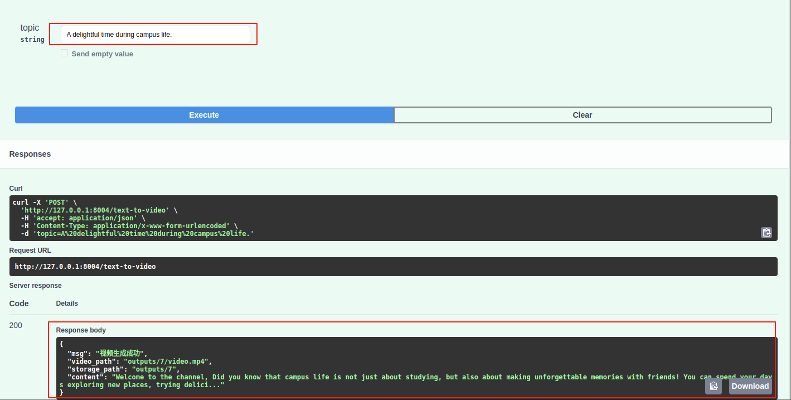
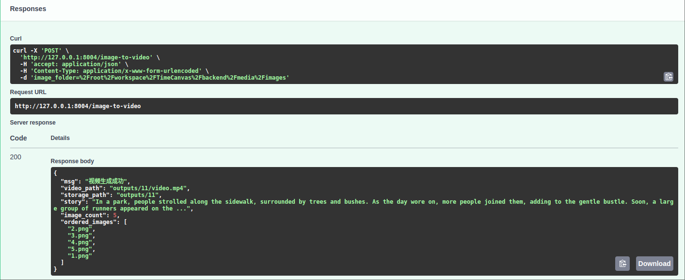

# TimeCanvas - 时光画廊

## 项目概述

TimeCanvas（时光画廊）是一个基于AI技术的智能相册管理系统，集成了图片管理、视频生成、数据可视化等功能。用户可以通过百度网盘授权登录，创建和管理个人相册，并利用AI技术进行内容创作和数据分析。

## 技术架构

### 后端技术栈
- **框架**: FastAPI (Python)
- **数据库**: SQLAlchemy ORM

### AI模型集成

#### 🤖 文本生成: LLaMA3.2
- **模型简介**: Meta开发的大型语言模型，擅长理解和生成自然语言文本
- **应用场景**: 根据主题生成故事内容、创建图片提示词、AI辅助写作
- **技术特点**: 支持多语言，逻辑推理能力强，生成内容连贯性好
- **模型优势**: 开源免费，在中文理解和生成方面表现优秀

#### 🎨 图像生成: Realistic_Vision_V5.1_noVAE
- **模型简介**: 基于Stable Diffusion的写实风格图像生成模型
- **应用场景**: 根据文本提示词生成高质量的写实风格图片
- **技术特点**: 专注于写实效果，生成图像细节丰富，色彩自然
- **模型优势**: 无需VAE组件，推理速度快，显存占用相对较小
- **生成规格**: 支持848x480分辨率，40步推理，适合视频制作

#### 👁️ 图像理解: BLIP (Salesforce/blip-image-captioning-large)
- **模型简介**: Salesforce开发的视觉-语言理解模型，专门用于图像描述生成
- **应用场景**: 分析图片内容，生成中英文描述，为故事生成提供素材
- **技术特点**: 结合视觉编码器和语言解码器，理解图像语义信息
- **模型优势**: 描述准确度高，支持多语言输出，模型规模适中
- **处理能力**: 能识别物体、场景、动作和情感，生成自然流畅的描述

#### 🔊 语音合成: TTS (tts_models/en/vctk/vits)
- **模型简介**: 基于VITS架构的高质量语音合成模型
- **应用场景**: 将文本内容转换为自然流畅的语音
- **技术特点**: 采用变分推理和对抗训练，生成语音质量高
- **模型优势**: 支持多说话人，语音自然度好，合成速度快
- **音质特点**: VCTK数据集训练，英音标准，适合教育和叙述类内容

#### 🎯 语音识别: WhisperX
- **模型简介**: OpenAI Whisper的增强版本，专注于精确的时间戳对齐
- **应用场景**: 从音频中提取文字和精确的时间戳，用于生成字幕
- **技术特点**: 结合VAD(语音活动检测)和强制对齐技术
- **模型优势**: 时间戳精度高，支持多语言，识别准确率优秀
- **输出格式**: 提供单词级别的时间戳，便于精确的字幕同步

#### 🎬 视频合成: MoviePy
- **框架简介**: Python视频编辑库，提供丰富的视频处理功能
- **应用场景**: 图片序列合成视频，添加音轨，生成字幕特效
- **技术特点**: 支持多种视频格式，提供丰富的特效和转场效果
- **功能优势**: 
  - 图片淡入淡出效果 (`fadein/fadeout`)
  - 智能时长分配 (根据音频长度自动调整图片显示时间)
  - 音频混合 (原声 + 背景音乐)
  - 字幕叠加 (支持自定义样式和位置)
  - 视频编码 (H.264/AAC标准格式)
- **特效支持**: 缩放、裁剪、色彩调整、转场动画等专业视频效果

### 前端技术栈
- HTML5/CSS3/JavaScript
- 响应式设计
- 数据可视化图表

### 核心功能模块
```
├── models/              # AI模型层
│   ├── text.py         # 文本生成模型
│   ├── image.py        # 图像生成和理解模型
│   ├── audio.py        # 音频处理模型
│   ├── subtitle.py     # 字幕生成模型
│   └── video.py        # 视频合成模型
├── routers/            # API路由层
├── crud/               # 数据访问层
├── schemas/            # 数据模型
└── dependencies/       # 依赖注入
```

## 项目特色功能

### 🎯 AI驱动的视频生成
系统提供两种AI视频生成方式：

#### 1. Text-to-Video（文本转视频）
- **功能**: 根据用户输入的主题自动生成完整视频
- **流程**: 
  ```
  用户主题 → AI文本生成 → 图片提示词 → AI图像生成 → 语音合成 → 字幕生成 → 视频合成
  ```
- **接口**: `POST /text-to-video`
- **技术亮点**: 端到端的多模态AI内容生成

**API接口展示:**


**生成效果演示:**
<video width="600" controls>
  <source src="backend/sample/text_to_video.mp4" type="video/mp4">
  您的浏览器不支持视频播放。
</video>

#### 2. Image-to-Video（图片转视频）
- **功能**: 分析现有图片，自动排序并生成故事视频
- **流程**:
  ```
  图片文件夹 → AI图像理解 → 内容分析 → 智能排序 → 故事生成 → 配音配乐 → 视频合成
  ```
- **接口**: `POST /image-to-video`
- **技术亮点**: 基于视觉理解的智能故事编排

**API接口展示:**


**生成效果演示:**
<video width="600" controls>
  <source src="backend/sample/image_to_video.mp4" type="video/mp4">
  您的浏览器不支持视频播放。
</video>

### 🤖 AI辅助创作
- **毕业寄语AI创作**: 根据用户需求生成个性化寄语
- **AI总结分析**: 对用户输入内容进行智能分析和总结
- **多语言支持**: 图像描述支持中英文切换

### 📊 数据可视化分析
- **地区分布图**: 同学地理位置柱状图和省份地图
- **星座雷达图**: 多维度星座分布分析
- **兴趣词云**: 基于文本分析的兴趣爱好可视化

## 首页介绍

当用户进入网页时，首先呈现给用户的界面是首页，首页主要进行了对整个项目的介绍，主要分为四个窗体高度的页面，用户可以通过鼠标滚轮来上下滑动浏览，第一页为首页标题，第二页展示时光画廊功能，第三页展示项目的细节，最后一页展示了版本信息。


## 用户登录使用流程

### 用户认证系统
- **登录方式**: 百度网盘OAuth授权登录
- **权限管理**: JWT Token认证机制
- **用户信息**: 自动获取百度网盘用户名和头像

### 用户登录
用户若不是第一次登录，或者已经使用百度网盘授权，则点击"请登录"，后前端可以获取到用户百度网盘的用户名和头像，并且可以使用时光画廊。用户登录成功后，点击菜单栏中的"相册"，可以展示3个系统相册，即同学录、趣事录和旅游志，对于每一个的背景图可以到"照片管理"处管理。


### 创建
用户点击系统相册后，若没有数据，则空白，否则展示用户添加的相册信息。用户可以通过点击头部菜单栏中"创建"来创建对应的相册，会在右侧有弹窗。


当用户成功创建相册后，会在页面呈现用户新添加的相册，其中背景图是默认的，若用户想要更改可以到"照片管理"处上传图片即可。


### 相册管理
用户点击菜单栏中"相册管理"后，会出现系统内所有用户现有的相册，表格第一列是相册类型，第二列是相册描述，第三列为相关操作。用户点击编辑后，对应的前两列即为可编辑状态，后点击保存，则可将用户更改的信息保存，并更新。用户点击"删除"则会删除用户相册的所有信息，包括相册及相册信息。


### 相册信息创建及使用
由于三种系统相册内关于相册信息创建及管理的方法类似，接下来主要拿同学录新建相册高中来举例，其余可依葫芦画瓢。
当用户点击新创建的相册后，可在左侧看到菜单栏。


用户点击"添加信息"后，会跳转到添加同学页面。当用户完整填写完信息后，点击确认则添加相册信息成功。


### AI辅助创作功能
对于创建中特别的是，当用户选中毕业寄语输入框后，会弹出一个弹窗。左侧有一个编辑框，用户在此输入毕业寄语，右侧有AI辅助创作，用户在右上框输入需求，点击"AI"按钮后，AI创作的结果在右下框呈现，用户可以选择自己满意的文本复制粘贴到左侧编辑框内。


当用户提交相册信息成功后，会提示用户到百度网盘内上传同学头像，则用户需到路径为"我的网盘/我的应用数据/TimeGallery/同学录/高中/李毅"下上传同学头像，成功后到相册内，可以在姓名列表中找到新添加的同学姓名，点击名字后，右侧呈现同学信息。


毕业寄语一栏右下角有"AI总结"按钮，点击后，可对毕业寄语进行分析，分析的结果会以弹窗的形式出现。


### 数据可视化分析
用户点击左侧导航栏中"管理"-"数据可视化"后，会弹出一个弹窗，内容为高中阶段同学地区分布柱状图、同学地区分布省份地图、星座雷达图、兴趣爱好词云图。


### 照片管理
用户点击菜单栏中"照片管理"即可进入跳转到新页面，可在选择框内选择想要管理的图片路径，这里的照片管理可以对系统相册和相册的背景图片进行更换，对相册信息内的图片进行管理，由于方法类似，下面只讲述高中相册内李毅同学的图片管理。后点击"上传具体时间图片"，右侧出现弹窗，用户可在此上传本地图片。上传成功后，在选择框内再次选择"同学录"-"高中"-"李毅"，下方出现新上传的图片信息，包括名称和大小。对于每一张图片可点击垃圾桶图标来删除，确认删除后，会提示删除成功，并且没有该图的信息。


### 视频管理
当用户点击"视频管理"即可进入新页面，用户在选择视频路径后。可点击"上传视频"来上传对应路径的视频。上传视频成功后，可选择对应路径来查看视频信息，包括视频名称、创建时间、视频大小及相关操作。相关操作包括在线播放视频和删除视频，点击对应按钮即可实现。


点击"在线播放视频"按钮后，会弹出弹窗，可进行视频播放操作，包括开始、暂停、声音大小调节等。


## 环境要求

### 系统要求
- Ubuntu 22.04.5 LTS (推荐使用Dev Container)
- Python 3.8+
- CUDA支持的GPU (用于AI模型推理)


## 项目亮点

### 🚀 技术创新
- **多模态AI集成**: 文本、图像、音频、视频全流程AI处理
- **智能内容理解**: 基于BLIP模型的图像语义理解
- **自动化工作流**: 端到端的AI内容生成管道

### 🎨 用户体验
- **零门槛创作**: 用户只需提供主题或图片即可生成专业视频
- **智能辅助**: AI辅助写作、内容总结、数据分析
- **可视化展示**: 丰富的图表和数据可视化功能

### 🔧 工程质量
- **模块化设计**: 清晰的代码架构和职责分离
- **RESTful API**: 标准化的接口设计
- **完善的错误处理**: 生产级的异常处理和日志记录
- **扩展性良好**: 支持新AI模型的插拔式集成

